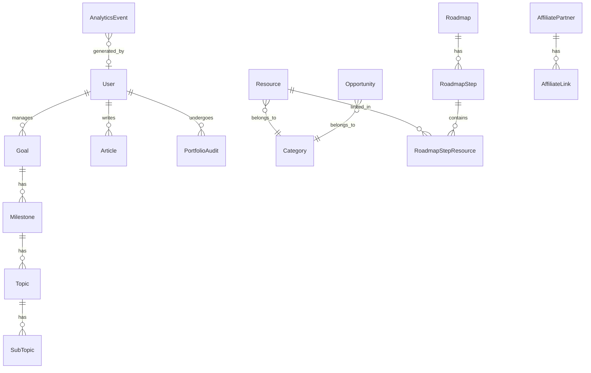

# 🎓 Seniofy — Project Report

> **Tagline:** *"Your Digital Senior, Always Ready."*

## 0. Project Biodata

| Attribute | Details |
|---|---|
| **Project Name** | Seniofy |
| **Domain** | EdTech / Career Development & Competitive Intelligence |
| **Target Audience** | Engineering & College Students (focusing on Indian students) |
| **Current Stage** | Production-Ready (Continuous Evolution) |
| **Platform Type** | Full-Stack Web Application / Learning Command Center |
| **Core Architecture** | Next.js 15 (App Router), React 19, Prisma ORM, PostgreSQL |
| **AI Integration** | Google Gemini API (with robust multi-key rotation & fallbacks) |
| **Project Lead/Developer** | Kishor / Seniofy Team |
| **Contact / Socials** | Twitter: [@GetSeniofy](https://x.com/GetSeniofy) \| IG: [@getSeniofy](https://www.instagram.com/getSeniofy/) |

---

## 1. Core Idea

Seniofy is a **high-authority engineering platform and virtual "clever senior"** for college students. It curates the best free resources, premium opportunities (Tier-1 internships, hackathons, etc.), career tools, and interactive AI-driven learning skill trees. It is designed to help students transition from beginners to senior-level developers by enforcing professional standards and providing intelligent guidance.

---

## 2. Feature Inventory

### 📚 Content Ecosystem

| Section | Description | Key Capabilities |
|---|---|---|
| **Resources** | Admin-approved learning resources | Category filtering, bookmarks, difficulty tiers (`BEGINNER`, `INTERMEDIATE`, `SENIOR`), `seniorInsight`, and automated `ResourceHealth` tracking. |
| **Opportunities Hub** | Competitive Intelligence Hub | Tiered categorization (`TIER_1` to `TIER_3`), stipend ranges, required skills, and external apply links. |
| **Engineering Blog** | Interactive Engineering Publications | TipTap rich-text editor, embedded Mermaid diagrams, Interactive Sandbox for code execution, and `clonableBlueprint` logic. |
| **Skill Trees (Roadmaps)** | Interactive learning pathways | Mermaid-powered Skill Trees (replacing linear roadmaps), branch logic, linked resources, and direct cloning into personal goals via "Architect this Path". |

### 🛠️ AI-Powered Tools Suite

| Tool | What It Does | AI Backend |
|---|---|---|
| **ATS Resume Optimizer** | Scores resumes against job descriptions, finds missing keywords, and gives actionable feedback. | Gemini API (with Key Rotation) + `pdf-parse` / `mammoth` |
| **Resume Architect / Project Gen** | Generates professional project blueprints enforcing ADRs, unit testing, and CI/CD standards. | Gemini API (with Key Rotation) |
| **Smart Study Planner** | Generates personalized, spaced-repetition AI study schedules directly into the user's Goals portal. | Gemini API (with Key Rotation) |
| **Portfolio Auditor** | Audits GitHub URLs for readability, architecture, and security, providing actionable refactoring feedback. | Gemini API (with Key Rotation) |
| **Plagiarism Checker** | Detects unoriginal content via document/text analysis. | Gemini API + Dolos API |

### 🎯 Goal Command Center

A gamified, AI-driven personal learning ecosystem:
- **Structure:** **Goals** → **Milestones** → **Topics** → **Sub-Topics** (completable checkboxes)
- **Tracking:** Automated streak tracking (current/longest), last activity dates, and total focus time tracking.
- **AI Integration:** Seamlessly holds AI-generated study plans and cloned Skill Tree paths.

### 👤 User & Admin Features

| Feature | Details |
|---|---|
| **Authentication** | NextAuth v5 (Credentials + Google OAuth), OTP Verification, and robust session versioning. |
| **Platform Telemetry** | Background `AnalyticsEvent` tracking for user interactions (e.g., `ROADMAP_CLONED`, `ATS_USED`) visualized in the admin dashboard. |
| **AI Provider Layer** | Fault-tolerant AI architecture with multi-key rotation and `runWithFallback` wrappers to prevent 429 rate-limiting. |
| **Admin Dashboard** | Extensive content management, user administration (5-tier RBAC), and affiliate link tracking. |

### 🛡️ Security & RBAC

- **5-tier role system:** `SUPER_ADMIN` → `ADMIN` → `EDITOR` → `CONTRIBUTOR` → `VIEWER`
- **17 granular permissions** (e.g., `CONTENT_MODERATE`, `AFFILIATE_MANAGE`)
- Rate limiting (Upstash Redis), failed login tracking, account lockout.
- Password history, CSRF tokens, security audit logs, session versioning.

---

## 3. Technology Stack

### Frontend
| Tech | Purpose |
|---|---|
| **Next.js 15** (App Router) | Full-stack React framework with SSR/SSG |
| **React 19** | UI library |
| **TypeScript** | Type safety |
| **Tailwind CSS 3** | Utility-first styling |
| **Framer Motion** | Animations & micro-interactions |
| **TipTap** | Rich-text editor with slash commands (`/affiliate`) |
| **Mermaid** | Diagram/flowchart rendering (Skill Trees & Articles) |
| **react-markdown + remark-gfm** | Markdown rendering for AI tool outputs |
| **tsparticles** | Particle effects for visual polish |

### Backend
| Tech | Purpose |
|---|---|
| **Next.js API Routes** | Server-side API endpoints |
| **Prisma ORM** | Database schema, migrations, and queries |
| **PostgreSQL** | Primary relational database |
| **NextAuth v5** (Auth.js) | Authentication (credentials + Google OAuth) |
| **Google Gemini API** | AI backbone (with custom Key Rotation Pool) |
| **Upstash Redis** | Rate limiting |
| **pdf-parse / mammoth** | Document parsing (PDF & Word) |
| **Vitest / ESLint** | Testing & Linting |

---

## 4. Database Architecture (Key Additions)

Recent architectural evolutions have significantly expanded the schema:
- **`AnalyticsEvent`**: Tracks platform telemetry (e.g., tool usage, searches) for dashboard insights.
- **`PortfolioAudit`**: Stores AI-driven feedback for user code/GitHub reviews.
- **`Opportunity` Additions**: `tier`, `difficulty`, `stipendRange`, `skillsRequired`, and `seniorInsight`.
- **`Resource` Additions**: `difficultyTier`, `seniorInsight`, and automated `healthStatus`.
- **`Goal` Additions**: `currentStreak`, `longestStreak`, `totalFocusTime`, and `aiStudyPlan`.

---

## 5. Monetization Opportunities

| Strategy | Current Status | How |
|---|---|---|
| **Affiliate Marketing** | ✅ **Built-in** | Embedded slash-command `/affiliate` links within articles and curated resources. |
| **Sponsored Opportunities** | 🟡 Easy to add | Companies pay to feature Tier-1 internships/deals on the opportunities board. |
| **Newsletter Sponsorship** | ✅ Built | Sell ad slots in weekly/monthly student newsletters. |
| **Premium AI Tools** | 🟡 Ready | Gate unlimited tool usage behind a subscription model. |
| **Student Deals Section** | ✅ Built | Partner with EdTech/SaaS companies for exclusive student discounts. |

---

## 6. Summary & Strengths

| Aspect | Assessment |
|---|---|
| **High Authority** | ✅ Upgraded to cater to senior engineering standards (ADRs, CI/CD, System Design). |
| **AI Reliability** | ✅ Multi-key Gemini rotation pool ensures 99.9% uptime for AI features against rate limits. |
| **Engagement** | ✅ Gamified Goal Command Center (streaks, focus time) & Interactive Engineering Publications. |
| **Data-Driven** | ✅ Robust Telemetry Engine capturing `AnalyticsEvent` data for continuous platform improvement. |
| **Scalability** | ✅ Next.js + PostgreSQL + Prisma architecture designed for high throughput and content volume. |

> **In one line:** Seniofy has evolved into a resilient, AI-powered engineering command center that not only curates high-tier opportunities but actively guides students through interactive, gamified learning pathways with professional-grade infrastructure.
