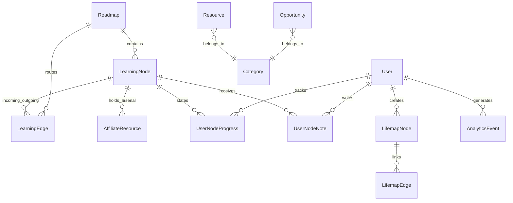

# 🎓 Seniofy — Project Report

> **Tagline:** *"Your Digital Senior, Always Ready."*

## 0. Project Biodata

| Attribute | Details |
|---|---|
| **Project Name** | Seniofy |
| **Domain** | EdTech / Career Development & Competitive Intelligence |
| **Target Audience** | Engineering & College Students (focusing on Indian students) |
| **Current Stage** | Production-Ready (Continuous Evolution) |
| **Platform Type** | Full-Stack Web Application / Learning Command Center |
| **Core Architecture** | Next.js 15 (App Router), React 19, Prisma ORM, PostgreSQL |
| **AI Integration** | Google Gemini API (with robust multi-key rotation & fallbacks) |
| **Project Lead/Developer** | Kishor / Seniofy Team |
| **Contact / Socials** | Twitter: [@GetSeniofy](https://x.com/GetSeniofy) \| IG: [@getSeniofy](https://www.instagram.com/getSeniofy/) |

---

## 1. Core Idea

Seniofy is a **high-authority engineering platform and virtual "clever senior"** for college students. It curates the best free resources, premium opportunities (Tier-1 internships, hackathons, etc.), career tools, and interactive AI-driven learning skill trees. It is designed to help students transition from beginners to senior-level developers by enforcing professional standards and providing intelligent guidance.

---

## 2. Feature Inventory

### 🌌 The Constellation Engine (Roadmap V2)

The platform recently underwent a massive architectural shift from linear checklists to a **DAG-based Spatial Learning Engine** (Directed Acyclic Graph).

| Component | Description |
|---|---|
| **Spatial Skill Graphs** | Roadmaps are now interconnected nodes rendered via React Flow. Users can pan, zoom, and visually understand prerequisite chains and dependencies. |
| **Topological Progression** | Nodes unlock automatically based on dependency completion (`LOCKED` → `UNLOCKED` → `COMPLETED`). |
| **The Drawer Interface** | Clicking a node opens a sliding panel containing the briefing, Markdown note-taking (cloud-synced), and the Arsenal. |
| **The Arsenal** | Replaces generic resource links with curated, high-value `AffiliateResource` items attached directly to the specific skill node. |
| **Admin Graph Forge** | A private, visual CMS canvas where admins can drag, drop, connect edges, and build roadmaps without touching database scripts. |

### 🧭 Lifemap (Personal Trajectory Graph)

| Feature | Description |
|---|---|
| **Lifemap** | A personal, visual DAG representation of a student's career trajectory. Instead of standard roadmaps, users create custom nodes (`LifemapNode`) representing their own specific deadlines, exams, or goals, and link them with edges (`LifemapEdge`) to build a spatial map of their future. |

### 🎯 Mission Control (Dashboard) & Dossier

| Section | Description | Key Capabilities |
|---|---|---|
| **Cold Start Protocol** | Onboarding Interceptor | Brand new users with empty dashboards are intercepted by a full-screen Matrix to select and initialize their first mission, preventing dead-ends. |
| **Mission Control** | User Dashboard (`/dashboard`) | Displays active missions, overall progress bars, next actionable nodes (deep-linked to auto-open drawers), and streak stats. |
| **Engineer Dossier** | Bento-Box Profile (`/profile`) | A sleek CSS-Grid layout showcasing the user's identity, Activity Heatmap (GitHub style), Current/Best Streaks, and earned Mission Trophies. |

### 📚 Content Ecosystem

| Section | Description | Key Capabilities |
|---|---|---|
| **Resources** | Admin-approved learning resources | Category filtering, bookmarks, difficulty tiers (`BEGINNER`, `INTERMEDIATE`, `SENIOR`), `seniorInsight`, and automated `ResourceHealth` tracking. |
| **Opportunities Hub** | Competitive Intelligence Hub | Tiered categorization (`TIER_1` to `TIER_3`), stipend ranges, required skills, and external apply links. |
| **Engineering Blog** | Interactive Engineering Publications | TipTap rich-text editor, embedded Mermaid diagrams, Interactive Sandbox for code execution, and `clonableBlueprint` logic. |

### 🛠️ AI-Powered Tools Suite

| Tool | What It Does | AI Backend |
|---|---|---|
| **ATS Resume Optimizer** | Scores resumes against job descriptions, finds missing keywords, and gives actionable feedback. | Gemini API (with Key Rotation) + `pdf-parse` / `mammoth` |
| **Resume Architect / Project Gen** | Generates professional project blueprints enforcing ADRs, unit testing, and CI/CD standards. | Gemini API (with Key Rotation) |
| **Smart Study Planner** | Generates personalized, spaced-repetition AI study schedules directly into the user's Goals portal. | Gemini API (with Key Rotation) |
| **Portfolio Auditor** | Audits GitHub URLs for readability, architecture, and security, providing actionable refactoring feedback. | Gemini API (with Key Rotation) |
| **Plagiarism Checker** | Detects unoriginal content via document/text analysis. | Gemini API + Dolos API |

### 🛡️ Security & RBAC

- **5-tier role system:** `SUPER_ADMIN` → `ADMIN` → `EDITOR` → `CONTRIBUTOR` → `VIEWER`
- **17 granular permissions** (e.g., `CONTENT_MODERATE`, `AFFILIATE_MANAGE`)
- Rate limiting (Upstash Redis), failed login tracking, account lockout.
- Password history, CSRF tokens, security audit logs, session versioning.

---

## 3. Technology Stack

### Frontend
| Tech | Purpose |
|---|---|
| **Next.js 15** (App Router) | Full-stack React framework with SSR/SSG |
| **React 19** | UI library |
| **TypeScript** | Type safety |
| **Tailwind CSS 3** | Utility-first styling (Bento-box grids, glassmorphism) |
| **Framer Motion** | Animations & micro-interactions (Landing page reveals) |
| **React Flow** | Interactive DAG rendering for the Constellation Engine, Lifemap & Graph Forge |
| **TipTap** | Rich-text editor with slash commands |
| **tsparticles** | Particle effects for visual polish |

### Backend
| Tech | Purpose |
|---|---|
| **Next.js Server Actions** | Secure backend mutations (`completeNodeAction`, `saveNodeNoteAction`) |
| **Prisma ORM** | Database schema, migrations, and queries |
| **PostgreSQL** | Primary relational database |
| **NextAuth v5** (Auth.js) | Authentication (credentials + Google OAuth) |
| **Google Gemini API** | AI backbone (with custom Key Rotation Pool) |
| **Upstash Redis** | Rate limiting |

---

## 4. Database Architecture (V2 Additions)

Recent architectural evolutions completely revamped the Roadmap system and Gamification metrics.

**Constellation Engine (DAG) Models:**
- **`LearningNode`**: Individual skills on a roadmap (has X/Y coordinates for rendering).
- **`LearningEdge`**: Defines prerequisite dependencies between nodes (`sourceNodeId` → `targetNodeId`).
- **`UserNodeProgress`**: Tracks per-user unlock/completion state of nodes (`LOCKED`, `UNLOCKED`, `COMPLETED`).
- **`UserNodeNote`**: Cloud-synced markdown notes written by users for specific nodes.
- **`AffiliateResource`**: Curated premium/free resources directly attached to `LearningNode`s.

**Lifemap Models:**
- **`LifemapNode`**: Custom, user-created nodes representing personal goals or milestones.
- **`LifemapEdge`**: User-defined edges linking their custom milestones.

**Gamification & Telemetry Additions:**
- **`AnalyticsEvent`**: Tracks platform telemetry (e.g., node completions, tool usage) to build the Activity Heatmap.
- **`User` Additions**: `currentStreak`, `longestStreak`, `lastActiveAt`.

---

## 5. Monetization Opportunities

| Strategy | Current Status | How |
|---|---|---|
| **The Arsenal (Affiliates)** | ✅ **Built-in** | High-conversion `AffiliateResource` links injected directly into active learning nodes precisely when the user needs them. |
| **Sponsored Opportunities** | 🟡 Easy to add | Companies pay to feature Tier-1 internships/deals on the opportunities board. |
| **Premium AI Tools** | 🟡 Ready | Gate unlimited AI tool usage (ATS, Portfolio Auditor) behind a subscription model. |
| **Student Deals Section** | ✅ Built | Partner with EdTech/SaaS companies for exclusive student discounts. |

---

## 6. Site Map & Page Architecture

This is a comprehensive map of all functional routes in the Next.js `src/app` directory.

### 🌐 Public & Marketing
| Route | Component/Purpose | Access |
|---|---|---|
| `/` | **Landing Page** (`LandingPage.tsx`). High-converting marketing gateway with Hero section, Feature Bento grids, animated backgrounds, and dynamic Roadmap vaults. | Public |
| `/about` | Static page about Seniofy's mission. | Public |
| `/contact` | Contact form for support or inquiries. | Public |

### 🔐 Authentication & Onboarding
| Route | Component/Purpose | Access |
|---|---|---|
| `/login`, `/signup` | NextAuth integration, Credentials + Google OAuth. | Public |
| `/forgot-password`, `/reset-password` | Password recovery flow. | Public |
| `/verify-email` | OTP email verification screen. | Public |
| `/onboarding` | Collects initial user data (role, university, goals) before granting access. | Auth |

### 🚀 Core User Experience
| Route | Component/Purpose | Access |
|---|---|---|
| `/dashboard` | **Mission Control**. Tracks active roadmaps, streak stats, and heatmap contributions. Also contains the **Cold Start Protocol** (`OnboardingMatrix.tsx`) for new users. | Auth |
| `/profile` | **Engineer Dossier**. A Bento-box layout showcasing the user's Github heatmap, streaks, and account settings. | Auth |
| `/lifemap` | **Personal Trajectory Graph**. A full-screen React Flow canvas where users build their own custom DAG of goals and timelines. | Auth |
| `/u/[username]` | Public-facing profiles for users. | Public |

### 🗺️ The Constellation Engine (Roadmaps)
| Route | Component/Purpose | Access |
|---|---|---|
| `/roadmaps` | The main library of all published roadmaps. | Public |
| `/roadmaps/[slug]` | **Constellation View**. The interactive spatial graph (DAG). Clicking nodes opens the sliding drawer (`NodeDrawer.tsx`) to show briefings, note-taking, and Affiliate Arsenals. | Public (View) / Auth (Progress) |

### 📚 Content & Tools
| Route | Component/Purpose | Access |
|---|---|---|
| `/resources` | Filterable library of curated learning materials. | Public |
| `/opportunities` | Internships, Hackathons, and Scholarships board categorized by Tiers. | Public |
| `/blog` | Articles published by the team/users. | Public |
| `/tools` | The AI Suite (ATS Resume Optimizer, Portfolio Auditor, Planner). | Auth |
| `/my-goals`, `/my-resources` | User-specific bookmarks and customized linear goals. | Auth |

### 🛠️ Admin Ecosystem (`/admin/*`)
| Route | Component/Purpose | Access |
|---|---|---|
| `/admin` | Admin dashboard overview (Analytics, user counts). | Admin / Super Admin |
| `/admin/forge/[slug]` | **Graph Forge**. Visual DAG builder canvas. Admins drag-and-drop nodes and connect edges to design roadmaps without coding. Includes Arsenal manager. | Admin |
| `/admin/users` | RBAC control, ban/lockout management. | Super Admin |
| `/admin/roadmaps`, `/admin/opportunities`, `/admin/resources`, `/admin/blog` | Standard CRUD tables/forms for all content types. | Admin / Editor |
| `/admin/submissions` | Moderation queue for user-submitted content. | Admin / Editor |
| `/admin/analytics` | Telemetry visualization based on `AnalyticsEvent` records. | Admin |

---

## 7. Summary & Strengths

| Aspect | Assessment |
|---|---|
| **High Authority** | ✅ Upgraded to cater to senior engineering standards with non-linear, spatial learning graphs. |
| **Engagement** | ✅ High retention driven by Mission Control dashboards, Bento-box dossiers, heatmaps, Lifemaps, and streak gamification. |
| **Conversion Engine** | ✅ Premium dark-mode marketing landing page and seamless "Cold Start Protocol" onboarding loop prevents drop-off. |
| **Admin Autonomy** | ✅ Visual Graph Forge allows administrators to build complex skill DAGs visually without code. |
| **Scalability** | ✅ Next.js + PostgreSQL + Prisma architecture designed for high throughput and rapid feature deployment. |

> **In one line:** Seniofy has evolved into a resilient, highly gamified engineering command center that replaces static tutorials with interactive, spatial skill graphs backed by professional-grade infrastructure.
